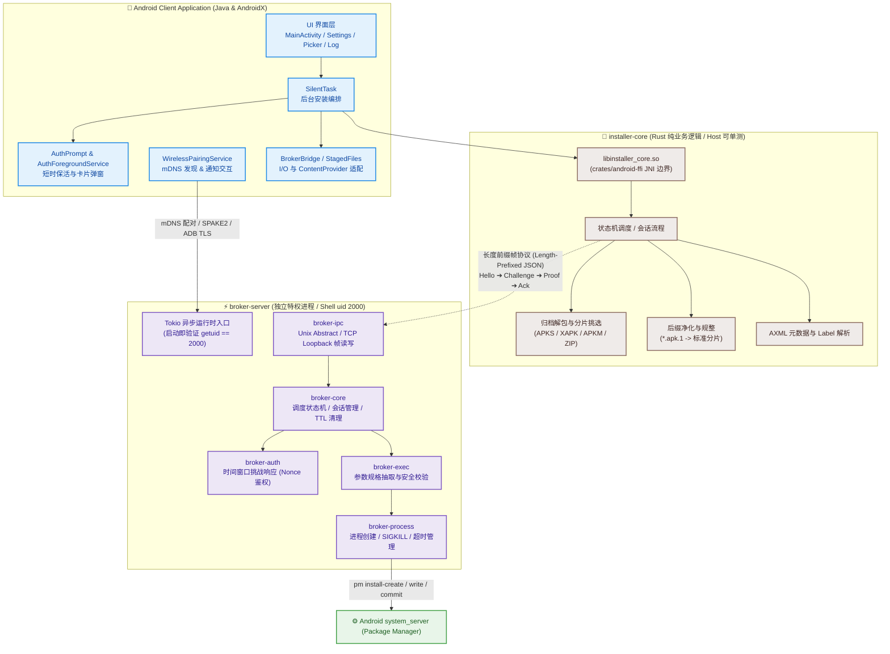
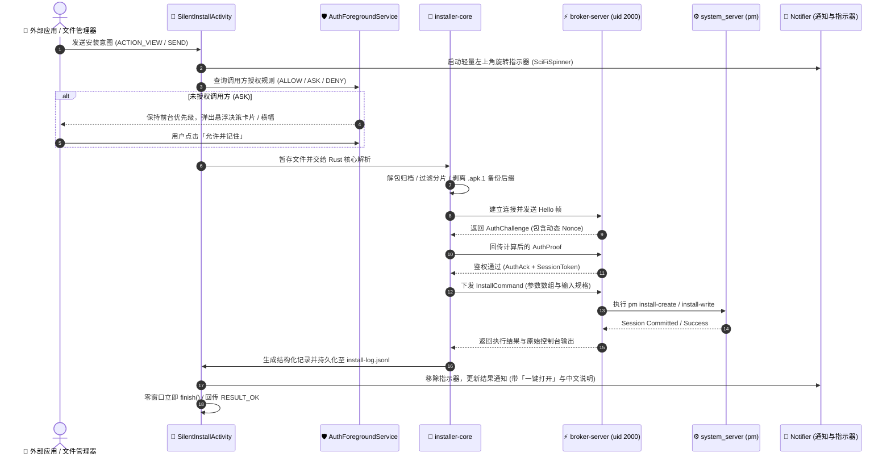

<div align="center">


# Android Privilege Broker

<p align="center">
  <b>⚡ 基于 Rust 核心与自主 ADB 特权代理的高性能 Android 静默安装与生命周期套件 ⚡</b>
</p>

<p align="center">
  <i>零弹窗交互 · 免电脑无线自启 · 16KB 内存页对齐 · 跨应用浮窗授权 · 本地原子审计日志</i>
</p>

<p align="center">
  <a href="https://github.com/LianXia233/android-privilege-broker/releases/latest"></a>
  <a href="https://github.com/LianXia233/android-privilege-broker/actions/workflows/build.yml"></a>
  <a href="LICENSE"></a>
  <a href="https://www.rust-lang.org/"></a>
  <a href="https://developer.android.com/about/versions/16"></a>
  
  
</p>

<p align="center">
  <a href="#-核心亮点">✨ 核心亮点</a> •
  <a href="#-快速开始无需电脑">🚀 快速开始</a> •
  <a href="#-系统架构">🏗️ 系统架构</a> •
  <a href="#-支持格式与交互协议">📦 支持格式</a> •
  <a href="#-深度工程机制与真机踩坑">🔬 深度机制</a> •
  <a href="#-编译构建与签名">🛠️ 编译构建</a> •
  <a href="CHANGELOG.md">📝 更新日志</a>
</p>

---

</div>

## 📌 项目基本概览

| 维度 | 规格 / 说明 |
| :--- | :--- |
| **应用包名** | `io.github.lianxia233.privbroker`（v2.0.0 起启用全新包名，与历史版本不互通） |
| **系统兼容** | minSdk **33**（Android 13+）/ targetSdk **36**（Android 16）/ compileSdk **36**，核心机制覆盖向下适配 |
| **特权边界** | 自主 Broker，**ADB Shell / uid 2000 唯一后端**；零 Root 依赖，不引入任何第三方特权框架 |
| **架构组成** | 纯业务逻辑在 `installer-core`（Rust，host 可单测）；特权执行在独立 `broker-server`（Rust + Tokio，12 个 crate）；无线链路在 `broker-wireless` |
| **产物交付** | 全 ABI 支持（`arm64-v8a` / `armeabi-v7a` / `x86` / `x86_64`）、**16KB 内存页对齐**、v1+v2 签名 |
| **开源许可** | **GNU General Public License v3.0（GPL-3.0-only）**，详见 [LICENSE](LICENSE) |
| **当前版本** | **2.1.18**（versionCode 25）；完整演进历史参见 [CHANGELOG.md](CHANGELOG.md) |

---

## ✨ 核心亮点

```
  ⚡ 真正的零感静默          📡 免电脑自主配对          🛡️ 跨应用卡片授权
  不弹界面 · 1x1 隐形窗口    mDNS + TLS 1.3 + SPAKE2   shortService 前台保活
  适配国产 ROM 过滤窗口      通知栏一键输入配对自启    无权限退化为交互横幅
──────────────────────────────────────────────────────────────────────────
  📦 全格式与恶意后缀还原    🔒 安全隔离与全量审计      🦀 模块化 Rust 特权后台
  APKS / XAPK / 分片归档    Shell uid 2000 隔离       12 个 Workspace Crate
  自动剥离 .apk.1 备份后缀   原子 JSONL 本地结构化日志  Tokio 异步引擎 + 端点自愈
```

### 功能清单 (Feature Matrix)

| 编号 | 核心功能 | 说明与技术特性 | 实现组件 / 源码位置 |
| :---: | :--- | :--- | :--- |
| **F-01** | **应用内无线自启** | 设备内自主启用无线调试与配对，**全程无需电脑或 USB 线** | `broker-wireless`, `WirelessPairingService`, `WirelessCore` |
| **F-02** | **零感静默安装** | 单 APK / 多 split / 归档分片包，自动处理社交软件追加的 `.apk.1` 等备份后缀 | `installer-core/install.rs`, `archive.rs`, `plan.rs`, `FileNames` |
| **F-03** | **静默安全卸载** | 支持保留数据卸载，提供已安装应用列表选择与高危系统应用二次警示 | `installer-core/uninstall.rs`, `AppPickerActivity`, `Uninstaller` |
| **F-04** | **免确认白名单** | 允许为可信调用方设置免确认白名单；安装前确认弹窗支持全局开关 | `crates/core/src/config.rs`, `SettingsActivity` |
| **F-05** | **动态通知交互** | 通知栏动态气泡展示安装进度与结果，支持一键拉起新应用或跳转查看日志 | `Notifier.java`, `SilentTask.java` |
| **F-06** | **结构化安装日志** | 本地自动记录安装时间、应用名、分片数、耗时、原始输出，支持分享与导出 | `logbook.rs`, `InstallLogStore.java`, `LogActivity.java` |
| **F-07** | **调用方弹性授权** | 首次调用由短时前台服务保活拉起悬浮卡片；无悬浮权限时自动退化为可交互横幅通知 | `auth.rs`, `AuthPrompt.java`, `AuthForegroundService.java` |
| **F-08** | **轻量后台指示器** | 屏幕左上角科幻风轻量旋转指示器，全屏点击穿透、不染黑系统状态栏 | `FloatingIndicator.java`, `SciFiSpinner.java` |
| **F-09** | **优雅失败降级** | 安装失败时默认仅发送一条低打扰通知，仅在用户点击时才交接给系统安装器 | `SilentTask.java`, `Notifier.java` |
| **F-10** | **本地化中文展示** | 通知、日志、错误堆栈精准显示 APK 内部 Label 中文名与易读错误原因 | `AppNames.java`, `apk_meta.rs`, `logbook.rs` |
| **F-11** | **双模写入与安全中转** | stdin 流式写入失败自动兜底为路径写入；中转落盘规避 FUSE 域 SELinux 拦截 | `install.rs`, `BrokerBridge.java`, `StagedFiles.java` |
| **F-12** | **安装后自动清理** | 支持安装成功后删除原始安装包；权限不足时特权代理以 shell 身份执行安全删除 | `SilentTask.java`, `BrokerBridge.java` |
| **F-13** | **关于与合规信息** | 提供完整构建版本、证书指纹、源码仓库直达与 GPL-3.0 许可说明 | `AboutActivity.java` |

---

## 🚀 快速开始（无需电脑）

普通 Android 应用无法自行获取特权，本项目创新性地将 **「无线调试服务发现 + TLS 配对 + ADB 协议握手 + 代理拉起」** 做成了无需电脑的自助闭环。


### 操作步骤

1. **开启无线调试**：
   - 打开系统「设置」→「开发者选项」→「无线调试」，打开总开关，并连接至 Wi-Fi 或自身热点。
2. **获取 6 位配对码**：
   - 在系统无线调试页面中，点击 **「使用配对码配对设备」**，界面将弹出 6 位数字配对码及配对端口。
3. **通知栏快速配对**：
   - 切换回本应用，点击 **「开始配对」**；
   - 系统通知栏将出现常驻前台服务通知，下拉通知栏，**直接在通知输入框内输入这 6 位配对码并点击发送**。
4. **自动激活与验证**：
   - 应用底层自动完成 mDNS 发现、RSA 证书注册、SPAKE2 密钥协商与 ADB TLS 握手，以 `shell(uid 2000)` 身份启动特权代理；
   - 回到应用首页，状态区自动更新为 **「已就绪」**，即可开始静默安装。

> [!TIP]
> **私钥安全保证**：配对所用的 2048 位 RSA 密钥由应用在本地安全生成，存放于私有保护目录 `filesDir/adb_key.pk8`，并在系统备份规则中显式排除，绝不上传云端，确保单机凭证安全。

---

## 🏗️ 系统架构

本项目采用清晰的三层解耦架构：**Android 交互与 I/O 适配层**、**Rust 业务核心逻辑层**、**独立特权执行代理（Tokio 异步运行时）**。

<details>
<summary><b>📜 展开查阅：v2 长度前缀通信协议白皮书与密码学细节</b></summary>

### 1. 二进制长度前缀帧规范 (Wire Format)
每个数据包由固定 **4 字节大端长度前缀** 和后续紧随的 **UTF-8 JSON Payload** 组成：
```
+-----------------------------------+---------------------------------------+
|  Length Prefix (4 Bytes, Big-End) |         Payload (UTF-8 JSON)          |
|           u32 (0 .. 1MB)          |            Envelope JSON              |
+-----------------------------------+---------------------------------------+
```
- **单帧上限**：`MAX_FRAME_BYTES = 1024 * 1024`（1MB），防止异常数据流耗尽代理内存。
- **协议版本**：当前为 `PROTOCOL_VERSION = 2`。版本不匹配直接返回 `VERSION_MISMATCH`。

### 2. 消息信封结构 (Envelope)
```json
{
  "version": 2,
  "seq": 1001,
  "client_id": "io.github.lianxia233.privbroker:client_01",
  "session_id": 2048,
  "timestamp_ms": 1731150000000,
  "ttl_ms": 10000,
  "body": {
    "type": "EXEC",
    "argv": ["pm", "install-create", "-r"],
    "stdin": { "type": "PATH", "path": "/data/local/tmp/prvbrk-stage/uuid/base.apk" },
    "env": [],
    "timeout_ms": 30000,
    "cancel_group": 1001
  }
}
```

### 3. SPAKE2 与 ADB TLS 密码学保障
- **密码协商**：采用 Edwards25519 曲线的 SPAKE2 算法，基于用户输入的 6 位瞬态数字完成强鉴权，免除证书导入门槛；
- **传输安全**：建立 TLS 1.3 隧道后，通过 24 字节小端 `A_*` 帧完成 `A_STLS` 协议升级并拉起 Shell 独立代理。

</details>



### 完整静默安装执行时序



---

## 📦 支持格式与交互协议

应用通过在 `AndroidManifest.xml` 中配置精细的 Intent 过滤器，实现了对各大应用市场、社交软件分发包的全面覆盖。

| 扩展名 / 格式 | 文件类型与来源 | 内部处理策略 |
| :--- | :--- | :--- |
| **`.apk`** | 标准单个 Android 安装包 | 直接建立会话并流式写入安装 |
| **`.apks`** | Android App Bundle (AAB) 导出的分片归档 | 自动解析 ZIP 目录，挑选有效 `.apk` 分片，优先挂载 `base.apk` |
| **`.xapk` / `.akp`** | APKPure 等三方平台的分片打包格式 | 按分片归档处理，提取内部全部分片 APK |
| **`.apkm` / `.apkmx`** | APKMirror 分片安装包格式 | 同上，自动识别架构并组合分片会话 |
| **`.zip`** | 包含多个 `.apk` 的通用压缩归档 | 同上，免解压流式过滤有效 APK 实体 |
| **`*.apk.1` / `*.apk.bin`** | **微信、QQ 等社交软件恶意改名的防拦截后缀** | **链路最前端统一剥离恶意后缀**，按原真实格式还原安装 |
| **多选文件** | 系统文件管理器多选分享 | 合并为单次 Multi-Split 协同安装会话 |

### 社交软件追加后缀处理机制

> [!NOTE]
> 微信、QQ 等社交平台在接收和转发 APK 时，会将 `app.apk` 强行重命名为 `app.apk.1`、`app.apk.2` 或追加 `.bin`、`.download`，从而阻止触发系统安装器。
> 
> 本项目在链路最前端通过 `FileNames.normalize()`（Java 端）与 `util::normalize_name()`（Rust 核心）实现双重净化：
> 1. `sample.apk.1` 会被精准剥离为 `sample.apk` 并按单包处理；
> 2. `bundle.apks.1` 会被正确剥离为 `bundle.apks` 并按分片归档解析；
> 3. 暂存文件名与日志中的显示名同步净化，彻底避免出现 `sample.apk.1.apk` 这种畸变命名。

---

## 🔬 深度工程机制与真机踩坑

本项目在真机（包括 HyperOS、MIUI、原生 Android 14/15/16 等系统）的实际调试中，攻克了大量系统底层限制与特殊场景。

<details>
<summary><b>1. 真正的零感静默：MIUI 结果忽略窗口与 1x1 隐形浮窗</b></summary>

- **零窗口执行**：多数文件管理器和分享操作不需要接收回执，入口 `SilentInstallActivity` 在 `onCreate()` 内立即触发 `finish()`。Android Framework 检测到 `mFinished = true` 会直接跳过 `wm.addView`，达成真正意义上的 **0 毫秒零窗口**。
- **1x1 隐形窗口适配**：对于通过 `startActivityForResult` 或带有 `EXTRA_RETURN_RESULT` 请求回执的调用方，入口使用定制的 `@style/SilentEntryTheme` 保持存活 1400ms，以绕过 MIUI/HyperOS 上著名的 **「1 秒结果忽略窗口」**。窗口被精确限制为 `1x1` 像素、全透明、不可聚焦、不可触摸、无 Dim、系统栏透明。
- **杜绝全屏灰色蒙层**：主题坚决不配置 `windowIsFloating`。在大量国内厂商 ROM 上，`floating + translucent` 会被窗口管理器错误铺成整屏半透明蒙层（早期版本偶尔出现的透明遮罩的根因）。

</details>

<details>
<summary><b>2. 代理单实例拉起：ash 内建 read 性能飞跃与进程名匹配坑</b></summary>

特权代理在每次激活时，必须先将历史残留实例清理干净，确保同一端点无端口冲突。在真机实测中解决了三个致命问题：

- **判据必须取 `/proc/pid/cmdline` 而非 `comm`**：
  `app_process --nice-name=xxx` 只会修改进程的 cmdline，Linux 内核中的 `comm` 依然会被 Android 运行时强制覆盖为 `main`（Java 主线程名）。若依据 `comm` 过滤，真机命中率永远为 0。因此必须解析 `/proc/pid/cmdline` 并对首参数做前缀锚定匹配（同时避开执行清理自身的 `sh -c`）。
- **Shell 内建 `read` 取代外部进程 fork（26 秒 ➔ 0.13 秒）**：
  启动命令是在无线调试 Shell 中异步下发的，投递后等待超时设定为 6 秒（`DETACHED_READ_TIMEOUT`），超时后 adbd 会强杀整个进程组。
  - **严重缺陷**：若使用 `$(tr -d '\000' < "$p/cmdline")` 遍历 `/proc`，在有 882 个进程的真机上会反复 fork 外部进程，耗时高达 **26.1 秒**，整条命令 28.6 秒才返回，必定触发超时被 adbd 强制清理，导致服务永远拉不起来！
  - **优化方案**：改用 Shell 内建的 `read` 命令直接读取 `/proc/pid/cmdline`，真机扫描时间直接骤降至 **0.13 秒**，整条启动命令 3.4 秒即可平稳返回！
- **握手全量验证判据**：
  端点端口是根据令牌派生的，若上个版本遗留了陈旧实例占住端口，纯端口探测会恒为真（导致假激活）。现全部统一为 `BrokerClient.handshake` 完整握手鉴权，杜绝假成功。

</details>

<details>
<summary><b>3. 跨应用授权：shortService 前台保活与无缝横幅降级</b></summary>

- **shortService 前台保活**：由于入口 Activity 追求零感静默会在拉起后立即 `finish`，Android 进程会瞬间降级为 `cached` 状态。在国产 ROM 上异步申请悬浮窗往往来不及弹出即被系统冻结。本项目通过拉起类型为 `shortService` 的 `AuthForegroundService`，将进程优先级钉在前台，决策完成或 90 秒超时后立即自我销毁，安全且合规。
- **通知横幅决策降级**：当设备未授予悬浮窗权限时，应用不会强行跳转主页打断用户，而是自动退化为一条**带有「允许并继续 / 拒绝」Action 按钮的即时横幅通知**。按钮携带完整请求上下文，用户直接在通知栏点击即可完成授权并无缝继续安装。
- **匿名调用安全防御**：无法识别调用方包名的匿名请求**绝对禁止勾选「永久记住」**，防止一次恶意放行导致系统安全防线失守。

</details>

<details>
<summary><b>4. 数据生命周期与 SELinux FUSE 域避坑</b></summary>

- **SELinux FUSE 域阻断**：应用私有外部存储虽然能被特权代理读取，但 `pm install-write <path>` 是由系统核心进程 **`system_server`** 打开文件的。`system_server` 访问属于 FUSE 域（`u:object_r:fuse:s0`）的文件时会被 SELinux 强制阻断（`avc: denied { read }`，`pm` 返回 255）。
- **随机临时中转机制**：兜底时应用将文件写到缓存后，特权代理以 shell 身份将文件复制到 `/data/local/tmp/prvbrk-stage/<随机目录>`。目录权限严格设为 `0711`，文件权限设为 `0644`，保证 `system_server` 可以按具体路径读取，其他普通应用无权枚举该目录。安装结束或异常退出时立即完整清空回滚。

</details>

<details>
<summary><b>5. 幻影进程防杀与端点自愈重拉 (BrokerReviver)</b></summary>

- **修正幻影进程配置**：早期指令中针对 Android 12+ 幻影进程监控的关闭命令存在命名空间错误。现已正规化为：
  ```bash
  settings put global settings_enable_monitor_phantom_procs false
  device_config put activity_manager max_phantom_processes 2147483647
  ```
- **安装中途端点自愈**：当安装或卸载链路偶发遇到 `BROKER_NOT_READY` 时，内置 `BrokerReviver` 会自动通过 mDNS 重新嗅探可用端口，并发起重拉与全握手校验。自愈成功后自动重试当次任务，全程无需用户重新输入配对码。

</details>

---

## 📱 平台兼容性矩阵

| 平台版本 | 对应 API | 重点适配特性与安全机制 |
| :--- | :---: | :--- |
| **Android 16** | API 36 | 严格 16KB 内存页对齐；显式声明 `android:exported`；适配最新编译工具链 |
| **Android 15** | API 35 | 全局 Edge-to-Edge 沉浸与 `fitsSystemWindows` 配色；1x1 隐形浮窗避让状态栏 |
| **Android 14** | API 34 | 跨应用授权采用 `shortService` 类型前台服务保活；所有 Intent 显式添加 `FLAG_IMMUTABLE` |
| **Android 13** | API 33 | 适配运行时 `POST_NOTIFICATIONS` 权限申请；通知分组与 Themed Icon 原生着色 |
| **Android 11+** | API 30~32 | 原生 ADB 无线调试通信通道；配置 `<queries>` 声明；`QUERY_ALL_PACKAGES` 枚举支持 |
| **Android 8~10** | API 26~29 | 系统悬浮窗 `TYPE_APPLICATION_OVERLAY` 兼容；自适应图标适配与旧版后台启动限制规避 |

### 关键权限声明说明

- `POST_NOTIFICATIONS`：用于展示安装进度气泡、结果通知以及在无悬浮窗权限时的横幅授权交互。
- `INTERNET` & `ACCESS_NETWORK_STATE`：无线调试与特权代理建立本地环回（Loopback TCP / Socket）通信的法定权限。
- `CHANGE_WIFI_MULTICAST_STATE`：用于 mDNS 组播发现局域网内的无线调试配对与连接服务。
- `SYSTEM_ALERT_WINDOW`：用于弹出优雅的跨应用授权悬浮卡片与左上角轻量进度指示器（可选，支持横幅通知降级）。
- `QUERY_ALL_PACKAGES`：仅用于在「设置」与「卸载应用」页面中枚举设备本地应用以供筛选配置，**绝不进行任何数据上传**。

---

## 🛠️ 编译构建与签名

### 构建环境依赖

- **Rust 工具链**：`stable` 版本，需安装 4 个 Android Target：
  ```bash
  rustup target add aarch64-linux-android armv7-linux-androideabi i686-linux-android x86_64-linux-android
  ```
- **构建工具**：`cargo-ndk` (`cargo install cargo-ndk`)
- **Android SDK & NDK**：
  - Android SDK Platform 36 / Build-Tools 36
  - Android NDK `27.2.12479018`
- **Java / Gradle**：JDK 17+，Gradle 8.14（仓库内置 `gradlew`）
- **Python 环境**：Python 3 + Pillow（用于图标及测试数据生成）

### 一键构建指令

```bash
# 1. 配置环境变量
export ANDROID_HOME=/path/to/android-sdk
export ANDROID_NDK_HOME=$ANDROID_HOME/ndk/27.2.12479018

# 2. 运行一键构建脚本
bash scripts/build.sh

# 产物输出于: PrivilegeBroker.apk
```

<details>
<summary><b>分步手动编译流程</b></summary>

```bash
# 1. 运行全 workspace 单元测试 (含协议/鉴权/会话/IPC 测试)
cargo test --workspace

# 2. 交叉编译 4 个 ABI 的 Native 动态库
cargo ndk -t arm64-v8a -t armeabi-v7a -t x86 -t x86_64 \
    -o android/app/src/main/jniLibs build --release -p installer-android-ffi

# 3. 编译打包 Android APK
cd android && ./gradlew assembleDebug

# 4. 可选：资源生成脚本
python3 scripts/gen_icons.py        # 重新生成各分辨率图标
python3 scripts/gen_axml_fixture.py # 重新生成测试样本
```

</details>

### 构建可复现性与固定签名保证

仓库在 `android/app/signing/release.keystore` 中分发了固定的自签名密钥，`build.gradle.kts` 将 `debug` 与 `release` 构建均强制指向该文件：

> [!IMPORTANT]
> - **沙箱本地构建与 GitHub Actions 云编译产出的 APK 签名证书完全一致（逐字节指纹相同）**，跨环境构建产物可直接相互覆盖安装。
> - 该密钥属于**公开的自签名可复现构建凭据**，专用于保证开源分发一致性与版本无缝升级，请勿当作私有商业发布证书使用。
> - 自 `v2.0.0` 起启用了全新 `applicationId`，如从旧版升级，请先卸载旧版本应用。

---

## 📂 仓库工程结构

```
android-privilege-broker/
├── .github/workflows/          # GitHub Actions 云编译与 Release 自动发布工作流
├── android/                    # Android 模块 (Gradle、Java 桥接、Manifest、资源)
│   ├── app/
│   │   ├── signing/            # 固定的可复现签名密钥 (release.keystore)
│   │   └── src/main/
│   │       ├── java/           # Android UI、前台服务、悬浮窗、协议客户端
│   │       └── res/            # 多语言字符串、布局、矢量资源
├── crates/                     # Rust 核心 Workspace (12 个独立 Crate)
│   ├── core/                   # installer-core: 业务状态机、命令规划、分片解包
│   ├── android-ffi/            # JNI cdylib 桥接层 (libinstaller_core.so)
│   ├── broker-protocol/        # v2 帧协议、4 字节大端长度前缀与数据结构定义
│   ├── broker-auth/            # 挑战响应鉴权、Nonce 管理与常量时间校验
│   ├── broker-exec/            # 特权执行规则定义、安全白名单参数审计
│   ├── broker-process/         # 异步进程引擎、SIGKILL 与超时销毁
│   ├── broker-ipc/             # Unix Abstract Socket / TCP Loopback 帧读写
│   ├── broker-android/         # UID 校验、SELinux 域嗅探与端点派生
│   ├── broker-core/            # Tokio 特权代理核心状态机与会话生命周期
│   ├── broker-client/          # Rust 客户端 SDK 与端到端集成测试套件
│   ├── broker-server/          # 独立特权后台进程主入口 (独立二进制/app_process)
│   └── broker-wireless/        # 无线调试协议栈 (mDNS / SPAKE2 / TLS 1.3 / ADB TLS)
├── icons/                      # 原始图标矢量素材与源图像
├── scripts/                    # 一键构建脚本 (build.sh) 与资源生成脚本
├── AGENTS.md                   # 仓库协作、编码与提交脱敏规范
├── CHANGELOG.md                # 完整版本演进历史记录
└── LICENSE                     # GNU GPL-3.0 开源许可协议
```

---

## 📜 开源许可与免责声明

- 本项目采用 **GNU General Public License v3.0（GPL-3.0-only）** 协议开源，完整协议文本请查阅 [LICENSE](LICENSE)。
- 仓库内附带的全部图标设计、图形资源与测试用例同样遵循 GPL-3.0 协议。
- **免责声明**：本项目通过 Android 官方无线调试规范获取 `shell(uid 2000)` 权限以执行常规的包管理操作，不提供 Root 越权能力。请确保安装来源合法可靠，开发者不对因安装第三方未知来源应用所导致的任何软硬件异常或数据丢失承担责任。

---

<div align="center">
  <b>Android Privilege Broker</b> • 由开源社区共同维护构建
</div>
